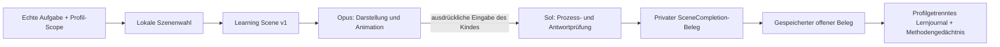

# Lumo Learning Scene Contract v1 · Übergabe an Opus

Implementierung: [Contract](../lib/domain/learning_intelligence/learning_scene_contract.dart),
[Scene Factory und Validator](../lib/domain/learning_intelligence/lesson_scene_engine.dart),
[lokale Entscheidungen](../lib/domain/learning_intelligence/lumo_intelligence_engine.dart).
Das [JSON-Beispiel](evidence/living-intelligence/place-value-scene-v1.json) wird vom
Produktionscode erzeugt und im Test wieder eingelesen; es ist kein handgezeichneter Entwurf.

## Zuständigkeit

Sol besitzt Lernziele, Methodenwahl, Lösungsschlüssel, Prozessprüfung,
Profilzuordnung und Speicherung. Opus darf die Darstellung und Bewegung der
bestehenden Original-Lumo-Figur aus diesem Datenvertrag umsetzen.



Animationen dürfen keine Lernzustände, Rewards oder Kompetenzen verändern.
`animation finished` ist kein Verständnisnachweis. Konstruktoren für bestätigte
SceneCompletion-Belege sind privat; die Scene Factory und Session prüfen sie.
Der bisherige boolesche Transferpfad bleibt kompatibel, erzeugt aber nur noch
unterstützte Beobachtungen. Selbstständiger Transfer benötigt den geprüften Beleg.

## Datenfelder

| Feld | Bedeutung |
|---|---|
| version | exakt 1; unbekannte Versionen werden abgelehnt |
| id, conceptId | Szenenkennung und Katalogziel; kein Kindername |
| method | verbal, pictorial, interactive oder guided |
| objects | Objektart, Menge und zugängliche Beschriftung |
| steps | Ziel, Anweisung, erlaubte Handlung, Prüfregel, Geste und mögliche Alternative |
| mood | attentive, thoughtful, encouraging oder joyful |
| animationState | Präsentationszustand; der aktuelle Produzent liefert ready |
| reduceMotion | Bewegung reduzieren, auch bei aktivem Android-Ruhemodus |
| accessibilityLabel | lesbare Beschreibung der dargestellten Szene |

Objektarten: tenRod, unitCube, wordCard, textCard. Jede Zehnerstange enthält
zehn sichtbare Einheiten. Der Decoder begrenzt Objekt-/Schrittanzahl, Mengen,
Textlängen und Antwortformate. Veränderte Quell-Maps verändern die Prüfregel
nicht; Regeln und Listen sind unveränderlich.

Die Runtime hält außerhalb des gespeicherten JSON den echten `TutorTaskScope`.
Feedback-Callbacks binden Task-ID und Profilgeneration an den dargestellten
Frame. Ein später Callback einer alten Aufgabe darf keine neue Aufgabe oder
ein Geschwisterprofil verändern. Keine Namen, Sprachaufnahmen, Touchkoordinaten
oder vollständigen Lernprofile an die Animationsschicht übermitteln.

Die alternative Methode im Step ist ein Darstellungsangebot. Sols Engine
entscheidet über den tatsächlich nächsten Schritt; bei erschöpften Verfahren
kann sie eine andere Aufgabe oder eine freiwillige Pause anbieten.

## Vollständige Referenz: Zehner/Einer

Die echte Aufgabe wird von `LearningContent` geliefert. Beispiel:
„Wie viele Zehner stecken in 84?“

1. Erst ausdrücklich angeforderte Hilfe: sprachlicher Denkanstoß ohne fertige
   numerische Lösung. Ansehen/Anhören verändert keine Kompetenz.
2. „Noch nicht verstanden“: eine bisher nicht versuchte Szene, zuerst bildlich,
   dann gegenständlich-interaktiv bzw. schrittweise. Methode und Rückmeldung
   werden lokal im richtigen Kinderprofil gespeichert.
3. Die Werkstatt lässt Stangen zählen und zehn Einzelwürfel bündeln.
   Diese Einführung erzeugt keinen selbstständigen Transfer.
4. Eine andere, im jüngsten Szenengedächtnis noch nicht verwendete Zahl wird
   selbst gebaut, beispielsweise 57. Erst danach folgt die Rückfrage nach den
   Einern außerhalb der vollen Zehner.
5. Nur korrekte Konstruktion **und** korrekte Rückfrage im jeweils ersten Versuch
   ohne zusätzliche Hilfe erzeugen einen unabhängigen Beleg. Korrekturen oder
   weitere Hilfe bleiben unterstützte Übung. Selbstständiges Lösen ist ein
   zusätzlicher Hinweis, keine Diagnose und noch keine umfassende Meisterschaft.

```dart
final lesson = PlaceValueLessonSession(
  sourceNumber: 84,
  targetNumber: 57,
  sourceProblemId: activeScope.problemId,
  sourceTaskId: activeScope.taskId,
  generation: activeScope.generation,
);
lesson.beginTransfer(); // nach ausdrücklicher Auswahl durch das Kind
final construction = lesson.submitConstruction(tens: 5, ones: 7);
// 4 Zehner + 17 Einer haben denselben Wert, bestehen diese Prozessprüfung nicht.
final receipt = lesson.submitComprehension(7);
// Nur Sol verarbeitet einen passenden, aktuellen Receipt über den Coordinator
// und die bestehende profilgebundene Speichergrenze. Opus schreibt nichts.
```

Tests: `scene_contract_test`, `transfer_process_test`, `transfer_scope_test`,
`live_alternative_scene_test`, `scene_memory_persistence_test` und der echte
Home→Aufgabe→Werkstatt→Folgeaufgabe-Durchlauf in
`test/design/lumo_tutor_brain_capture_test.dart`.

## Weitere Unterrichtsbereiche und Grenzen

Der Katalog ordnet vorhandene Aufgaben aus Mathematik, Deutsch, Lesen,
Rechtschreibung und Sachunterricht zu. Das ist eine partielle Aufgabenlandkarte,
keine bestätigte vollständige österreichische Lehrplanabdeckung.

Für Textstellenbezug und geordnete Silben/Satzbausteine bestehen überprüfbare
Contract-Regeln. Deren vollständige produktive Werkstätten und eigene
konzeptspezifische Transferprüfungen gehören zum nächsten Meilenstein.
Eine allgemeine richtige Antwort in einer verknüpften Unit bestätigt nicht
automatisch das ganze Teilkonzept.

Neue Animationen benötigen keine neue Figur: Original-Lumo und vorhandene Posen
verwenden. Touch-Ziele mindestens 48dp; Text muss bei 2x Skalierung umbrechen;
keine Lerninhalte mit einem Overlay verdecken. Die vorhandene Stimme bleibt
hinter ihren Einstellungen; ein Szenenwechsel startet kein Mikrofon.
