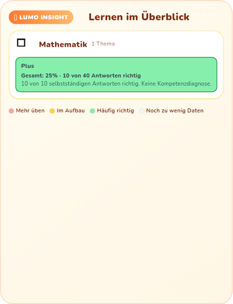
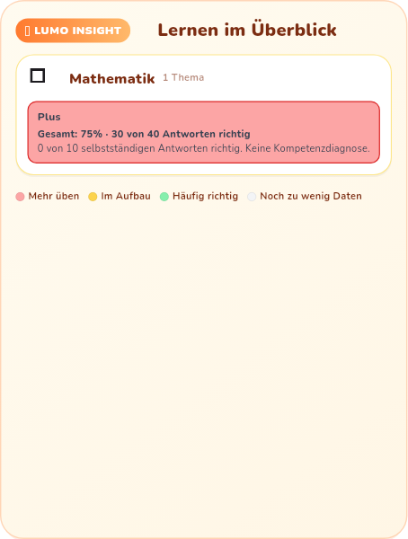

# Begleitete Übung und selbstständige Evidenz

## Befund und Änderung

Die produktive Aufgabenbearbeitung meldet eine angeforderte 3D-Erklärung bereits
als `helpUsed`/`hintUsed`. Die anschließende Bewertung addierte trotzdem alle
richtigen Antworten zur Fähigkeit und Erfolgsserie. Der vorher ausgeführte
Regressionstest reproduzierte unter anderem einen Sprung von `0.20` auf `0.85`
nach einer begleiteten Antwort sowie eine Schwächebewertung nach angeleiteten
Fehlern. Die sieben ersten gezielten Tests schlugen vor der Korrektur fehl.

`IndependentEvidence` hält selbstständige richtige/falsche Antworten und deren
Serien getrennt von der vollständigen Übungshistorie. `SkillStateUpdater` und
`LearningProfileEngine` zählen begleitete Antworten weiter als Aktivität; sie
erhöhen damit weder Fähigkeit, Schwierigkeit noch selbstständige Erfolgsserie.
Angeleitete Fehler erzeugen keine neue Schwäche-, Frustrations- oder
Handschriftbewertung. Ein späterer eigenständiger Versuch kann die begleiteten
Antworten nicht erneut in die Fähigkeitsquote einrechnen. Echte eigenständige
Transferaufgaben erhöhen den Lernstand weiterhin nach den bestehenden Regeln.

Schwierigkeitsfenster, Schwächenerkennung, Lernbaum und Lern-DNA verwenden diese
gleiche Evidenz. Lern-DNA-Gesamtzahlen bleiben erhalten. Bei gemischten Daten
benennt die Oberfläche die Gesamtquote und den eigenständigen Anteil getrennt;
Gruppierung, Hinweispriorität und Farbe beziehen sich auf den eigenständigen
Anteil. Die bestehende Mindeststichprobe von zehn Antworten für die Lern-DNA
gilt nun für eigenständige Antworten. Diese Gruppierung ist weiterhin keine
validierte Kompetenzdiagnose.

## Datenbestand und Grenzen

- Alte `correct`, `wrong`, `hintCount`, Serien, Schwierigkeit und Zeitstempel
  werden beim Einlesen nicht umgeschrieben. Das zusätzliche versionierte Feld
  `independentEvidence` wird mit der vorhandenen lokalen Speicherung gesichert.
- Alte Historie mit explizit null Hilfen bleibt zuordenbar. Bei gemischten alten
  Summen oder fehlender Hilfenangabe lässt sich die eigenständige Teilmenge nicht
  rekonstruieren. Die Historie bleibt sichtbar, gilt aber bis zu neuen
  eigenständigen Antworten nicht als Stärken-/Schwächennachweis.
- Unbekannte Versionen, inkonsistente oder beschädigte Evidenz werden abgelehnt;
  die ursprünglichen gespeicherten Bytes bleiben erhalten. Profil B bleibt bei
  einer Migration von Profil A unverändert.
- Das Upgrade liest das bisherige Format. Ein Downgrade auf ältere Programme mit
  strenger Feldliste unterstützt das neue Zusatzfeld nicht; die Tests belegen
  den Upgrade- und Wiederherstellungspfad, keinen Versions-Downgrade.
- Übungsbelohnung und tägliche Aktivität bleiben möglich; eine begleitete Antwort
  löst keinen Bonus für einen angeblichen Fähigkeitszuwachs aus.
- Original-GLB, Skelett, Teacher-Animation und Jump-Szenen wurden durch diese
  Bewertungskorrektur nicht verändert. Der Hashvergleich gegen den zuvor
  geprüften nativen Quellstand liegt in `RESULT.json`.

## Tatsächlich ausgeführte Prüfung

Flutter 3.44.9 / Dart 3.12.2, lokaler Flutter-Test-Runner, keine Netz-KI und keine
echten Kinderdaten. 91 Tests aus den folgenden zehn Dateien bestanden:

```
test/assisted_learning_evidence_test.dart
test/assisted_learning_dna_test.dart
test/reward_engine_test.dart
test/progress_repository_corruption_test.dart
test/progress_repository_storage_test.dart
test/learning_profile_isolation_test.dart
test/adaptive_task_help_test.dart
test/tutoring/native_learning_launch_test.dart
test/learning_dna_evidence_test.dart
test/parents/learning_dna_dashboard_evidence_test.dart
```

Die beiden neuen Dateien enthalten 23 Tests zu drei begleiteten Antworten,
eigenständigem Transfer, Hilfen ohne Bewertungsnachteil, späterer Neuberechnung,
Belohnungen, JSON-Wiederherstellung, unbekannten Formaten, Profiltrennung und
gegenteiligen Gesamt-/Eigenständigquoten. Die vorhandenen Tests prüfen zusätzlich
Speicherfehler, Wiederholung, echtes Starten der passenden nativen Lernhilfe,
Prüfungsmodus und Elternfreigaben. Die Dart-Analyse aller zwölf geänderten
Code-/Testdateien meldet keine Probleme; `git diff --check` ist sauber.

Rohlogs, exakte Befehle und Quellhashes:
[`evidence/assisted-learning-20261113/RESULT.json`](evidence/assisted-learning-20261113/RESULT.json).
`before.log` ist der echte Lauf der ersten sieben Tests vor dem Patch; Zeilen
beziehen sich auf deren damaligen kleineren Umfang. `after.log` ist der echte
abschließende Lauf mit 91 bestandenen Tests.

## Visuelle Evidenz

Die PNGs wurden aus dem tatsächlichen Flutter-Renderer der produktiven
`LumoInsightHeatmap` erzeugt. Grün bleibt ein selbstständig sicherer Bereich,
auch wenn viele vorangegangene angeleitete Fehler die Gesamtquote senken; Rot
zeigt eigenständigen Übungsbedarf trotz vieler zuvor angeleiteter Erfolge.
Beide Quoten bleiben ablesbar. Die Testumgebung stellt das Fach-Emoji ohne
passende Emoji-Schrift als Ersatzzeichen dar.





Diese Bilder sind Flutter-Test-Rendererbilder, kein Galaxy-Z-Fold7-Gerätetest,
keine Android-Lebenszyklusprüfung und kein 60-FPS-Nachweis. Den GitHub-Checkpoint,
nativen Pin und integrierten APK-Kandidaten verantwortet der zentrale
Integrationsstand; diese Bewertungstests allein stellen keinen Release dar.
