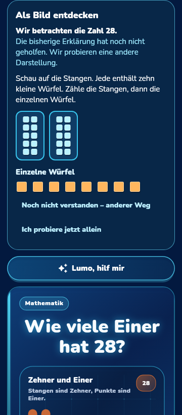
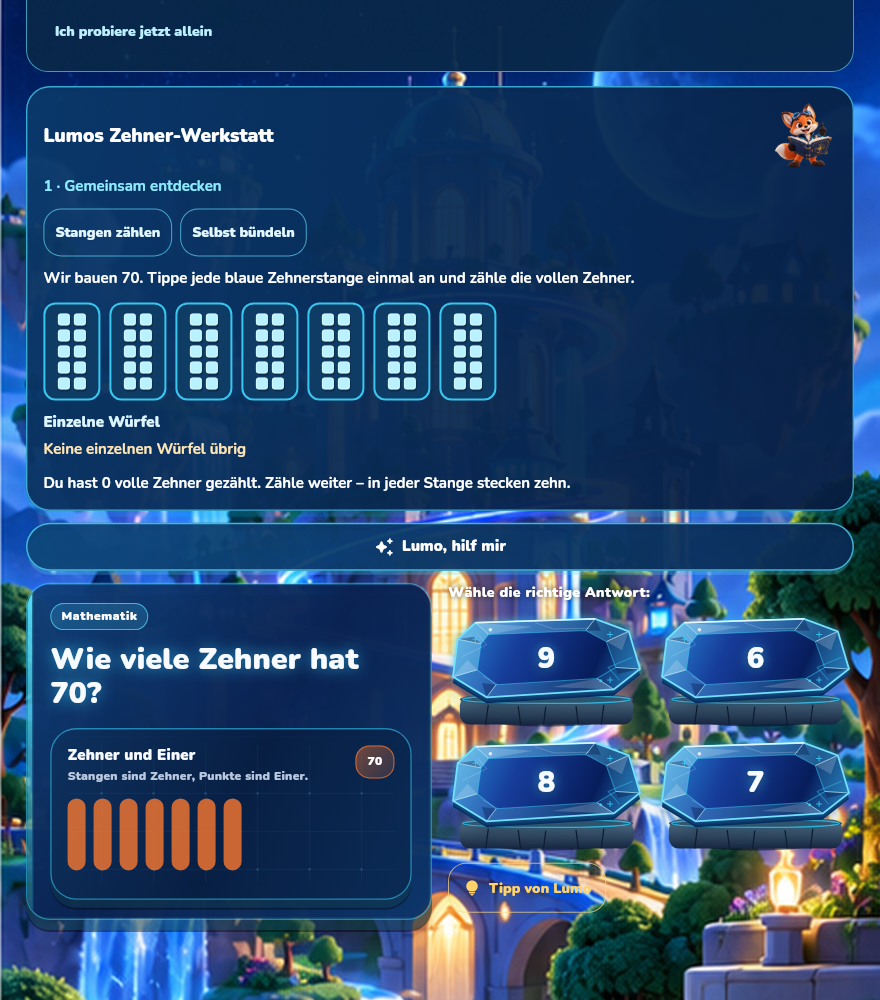

# Living Intelligence · Meilenstein 1

Der erste verbindliche Tutor-Durchlauf ist geprüft: Nach abgelehnter Erklärung
wählt Lumo eine andere Lernszene. Das Kind baut anschließend eine andere Zahl,
beantwortet eine Prozessfrage und erhält einen lokal gespeicherten, nach
Neustart nachvollziehbaren Beleg. Einführung und richtige Ergebnisse mit
falscher Zerlegung gelten nicht als selbstständiger Transfer.

## Quellstände und GitHub

| Stand | Nachweis |
|---|---|
| Erhaltene Ausgangsbasis | `9fdfc3f17e640ade0912411167d4af2f73be8720` |
| Geprüfter Tutor-Kern | `5d6d7dcd0ebbff48b7c7850b0e392a9086ea1ecc`, [Draft-PR #414](https://github.com/Ullmann27/lumo-lernen/pull/414) |
| Separater 2002-Auslieferungskandidat | `ff791642a0d28d10f89d98025fd8f5fb2c19c403`, [Draft-PR #415](https://github.com/Ullmann27/lumo-lernen/pull/415) |
| Unveränderter nativer Quellstand | `adcce3093caa42bf3da47262f70bdf03cdefa347`, Godot 4.6.3 |

Die Nachweisdokumentation liegt separat auf
`docs/lumo-living-intelligence-verification-20261029`. Sie verändert keine
geprüfte Build-Quelle. `main`, PR #411–413 und der bisherige 2001-Branch bleiben
erhalten. Es wurde kein veröffentlichter APK-Inhalt ersetzt.

## Konkrete Fähigkeiten

- Vier feste, fachlich überprüfbare Erklärverfahren: sprachlich, bildlich,
  mit Zehnermaterial und schrittweise. Nach ausdrücklichem Nichtverstehen
  wechselt die Engine das Verfahren; nach erschöpften Alternativen bietet sie
  einen anderen Einstieg oder eine freiwillige Pause an.
- „Erklär es Lumo“ für Zehner/Einer: selbst zählen/bündeln, eine neue Zahl bauen
  und die Einer außerhalb der vollen Zehner zeigen. Falsches Bündeln trotz
  richtigen Gesamtwerts wird getrennt vom Ergebnis erkannt.
- Zusätzliche Hilfe während der neuen Aufgabe, Korrekturen und Raten bleiben
  unterstützt. Nur eine neue, beim ersten Versuch selbstständig gebaute und
  richtig erklärte Aufgabe erzeugt zusätzliche unabhängige Evidenz.
- Lokales Methodengedächtnis und dauerhafter Zwischenbeleg für Journal und
  Szenenbeobachtung. Neustart, fehlgeschlagene Teil-Schreibvorgänge und Retry
  erzeugen keine doppelte Evidenz. Geschwister bleiben getrennt.
- Beobachtungen und bestätigte Prozesse sind getrennt. Ohne passenden
  Validatorbeleg bestätigt ein guter Unit-Zähler kein umfassendes Konzept.
  Der 14-Knoten-Graph bildet eine partielle, tatsächlich erreichbare Aufgabenlandkarte.
- Drei kurze, abwechslungsreiche tägliche Einstiege verwenden reale
  Lernaufzeichnungen und die Schulstufe. Eltern sehen gespeicherte Gründe.
- [Learning Scene Contract v1](../../LUMO_LEARNING_SCENE_CONTRACT_V1.md) für Opus,
  mit erzeugtem JSON, Codec-/Regeltests und kompletter Zehner/Einer-Referenz.
  Animationen dürfen keine Kompetenzen oder Rewards schreiben.

Der Grundbetrieb benötigt keine Cloud-KI und aktiviert kein Mikrofon.
Vorhandene lokale Sprach-/Tutorfunktionen wurden geprüft und erhalten.

## Tatsächliche Prüfungen

| Prüfung | Ergebnis |
|---|---|
| GitHub-Kernlauf #40846028231 auf 5d6d7dcd | erfolgreich; 1.952 Flutter-Tests, 171 übersprungen; zusätzlich 43 fokussierte Fälle |
| GitHub-Kernlauf #40846950258 auf ff791642 | erfolgreich; erneut 1.952 + 43 Fälle, 171 übersprungen |
| Vollanalyse beider Quellen | 0 Fehler, 6 bestehende Warnungen, 106 Hinweise |
| Change-Review #40846027846 und #40846950262 | erfolgreich am jeweiligen Quellstand |
| Lokale 2002-Skripttests | 208 ausgeführt, einer übersprungen |
| Lokale Android-Probe-/OCR-/Preservation-Tests | 656 bestanden |
| Frischer unabhängiger Review | keine kritischen; drei wichtige und zwei kleinere Befunde; alle fünf korrigiert und durch gezielte Tests geprüft |

Die beiden Kern-Artefakte wurden heruntergeladen und gegen den von GitHub
gelieferten ZIP-SHA-256 geprüft. [Quellstand, Bild- und Log-Hashes](../../evidence/living-intelligence/github-core/verification.json)
und [2002-Prüfdaten](../../evidence/living-intelligence/github-core/release-core-verification.json).

Die zehn synthetischen Vergleichsfälle verwenden die echte eingefrorene
9fdf-Tutorlogik. Drei Entscheidungen ändern sich, sieben bleiben gleich;
innerhalb dieser Fallauswahl wurde keine schlechtere Entscheidung beobachtet.
Das ist keine empirische Lernwirksamkeitsstudie. Einzelheiten und sämtliche
Review-Korrekturen stehen in [STATUS](STATUS.md).

## Echte Aufnahmen

13 produktiv gerenderte Flutter-Aufnahmen decken 360×820, 280×740 mit 2× Schrift
und 880×1000 ab. Die Eingaben laufen durch echte Widgets, Aufgaben und Speicher.
Ausgewählte Bilder stammen zusätzlich direkt aus dem erfolgreichen GitHub-Lauf:

Das sind Flutter-Laufzeitaufnahmen, keine Bildentwürfe. Sie beweisen keine
physische Fold7-Leistung; native Android-Aufnahmen gehören zum eigenen Gate.

## Android-Stand

Der neue signierte Haupt-App-Kandidat ist `0.12.90+2002`, getrennt vom
reservierten 2001. Lernkern-CI und Sicherheits-/Datenerhaltungstests sind
bestanden. Der signierte ARM64-/x86_64-Gesamtbuild ist ebenfalls erfolgreich.
Echte Android-/Kart-Tour, tatsächliches 2000→2002-Update und
Veröffentlichung laufen noch. Bis zu deren Abschluss besteht keine neue
APK-Freigabe; Build 2000 bleibt die letzte veröffentlichte Haupt-App.

Die Wiederaufnahme für andere KIs ist in [HANDOFF.md](HANDOFF.md) vollständig
beschrieben und direkt aus AGENTS.md, CLAUDE.md, CODEX_START.md und der
root-CONTINUE.md auffindbar. Der Handoff-Zweig enthält beide Arbeitszweige;
seine Dokumentation verändert die laufende 2002-Quelle nicht.

## Fachliche Grenzen und Fortsetzung

Die vollständige produktive Referenz ist Zehner/Einer. Lesen-, Silben- und
Satzbau-Regeln sind getestet; vollständige eigene Werkstätten und neue
Prozessvalidatoren folgen schrittweise. Nicht alle 268 dokumentierten
Klasse/Fach/Thema-Kombinationen besitzen schon die neue Szenenanbindung.
[Modulprüfung und konkrete nächste Anschlüsse](MODULE_INTEGRATION_AUDIT.md).

Schreibtrainer, Diktat-Selbsteinschätzung, Journal, Wallet und Kart wurden
erhalten. Eine neue lokale Spracheingabe oder neue Modellressourcen werden
erst nach echtem technischen Nachweis eingeführt. Der Meilenstein behauptet
keine vollständige Lehrplanabdeckung und keine Diagnose aus wenigen Antworten.
