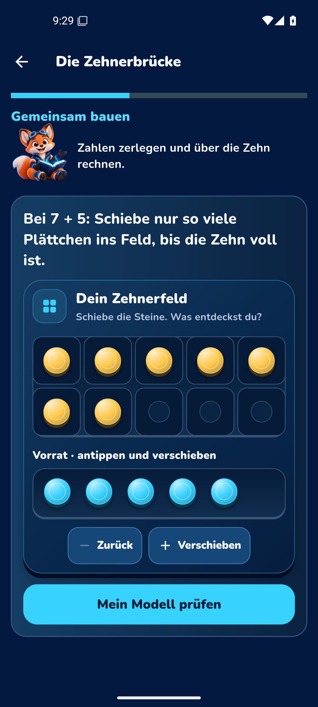

# Lumo Lernen 2002 · Veröffentlichung nachgeprüft

Die nächste Haupt-App ist veröffentlicht und direkt über Chrome herunterladbar:

**[Lumo Lernen 0.12.90 (2002) · ARM64-APK](https://github.com/Ullmann27/lumo-lernen/releases/download/lumo-0.12.90-2002/Lumo-Lernen-0.12.90-2002-ARM64.apk)**

Veröffentlichung: 29.10.2026, 09:48:56 UTC. Unabhängige Nachprüfung am
30.10.2026: Download ohne Anmeldung per HTTPS erfolgreich, vollständige Datei
erneut durch `scripts/verify_unified_apk.py --abi arm64-v8a` geprüft. Das Ergebnis
stimmt exakt mit dem veröffentlichten `APK-VERIFICATION.json` überein.
Die vorhandene signierte Haupt-App-Testserie wird aktualisiert; dies ist keine
Demo-App und keine Aussage über eine Play-Produktionssignierung.

| Merkmal | Geprüfter Wert |
|---|---|
| Version / versionCode | `0.12.90` / `2002` |
| APK-Größe | 317.179.546 Bytes |
| Anwendungspaket | `dev.ullmann.lumo.lumo_lernen.coachpreview` |
| Flutter-Quellstand | `ff791642a0d28d10f89d98025fd8f5fb2c19c403` |
| Godot-Quellstand | `adcce3093caa42bf3da47262f70bdf03cdefa347`, Engine 4.6.3 |
| APK-SHA-256 | `17483a730bb9a1a13e4bcf5a2d733523a4da07983a0aadc38a980f5d771a9c76` |
| Signaturzertifikat SHA-256 | `a6b1ef61bf59db4e0794c742aeb3b5506d130f4d21175c9975140e6acdb80702` |
| Eingebettetes Godot-PCK SHA-256 | `cc5b7574ff31ad6c43b8cc08a8dd6aad7e6681b8c576e1099d08016e92473a30` |

Die unabhängige lokale Prüfung umfasste Signatur, Paket und Version, ausschließlich
ARM64-Bibliotheken, ELF-/Ressourcen-Ausrichtung, eingebettete Godot-Quelle und
PCK-Prüfsumme sowie die tatsächlich enthaltenen Offline-Sprachmodelle und Clips.
Kein Release-Asset wurde verändert oder erneut hochgeladen.

## Erfolgreiche Gates am veröffentlichten Quellstand

| Gate | Nachweis |
|---|---|
| Lernkern-CI | [40846950258](https://github.com/Ullmann27/lumo-lernen/actions/runs/40846950258): 1.952 Flutter-Tests, 171 übersprungen; 43 fokussierte Fälle zusätzlich separat bestanden |
| Vollständige Change-Review-Prüfung | [40850306304](https://github.com/Ullmann27/lumo-lernen/actions/runs/40850306304): erfolgreich |
| Haupt-App-Build und echte Android-/Kart-Tour | [40846950267](https://github.com/Ullmann27/lumo-lernen/actions/runs/40846950267): erfolgreich |
| Tatsächliches 2000→2002-Update | [40846950656](https://github.com/Ullmann27/lumo-lernen/actions/runs/40846950656): erfolgreich |
| Veröffentlichung | [40846950358](https://github.com/Ullmann27/lumo-lernen/actions/runs/40846950358): erfolgreich |

Vollanalyse: keine Fehler, sechs bestehende Warnungen, 106 Hinweise.
Die Android-Proof-ZIPs wurden über die verbundenen GitHub-Tools heruntergeladen
und gegen die von GitHub angegebenen Digests geprüft. Original-Ergebnisdateien,
Build-Provenienz und ausgewählte unbearbeitete Screenshots sind dauerhaft im
Repository unter [android-2002](../../evidence/living-intelligence/android-2002) gesichert.
[Maschinenlesbare Gesamtprüfung](../../evidence/living-intelligence/android-2002/release-verification.json).

## Tatsächliche Datenerhaltung

Auf Build 2000 wurde per sichtbarer Oberfläche ein synthetisches Kinderprofil
angelegt und eine Aufgabe gelöst. Danach wurde 2002 mit `adb install -r`
installiert. Android-User-ID und Erstinstallationszeit blieben identisch;
versionCode stieg von 2000 auf 2002. Sechs vorhandene Lernschlüssel wurden
verglichen: Testprofil, eine gespeicherte richtige Antwort, ein verdienter Stern
und fünf XP blieben erhalten. Der Nachweis wurde nach Offline-Kart, App-Neustart
und den Displaygeometrien cover/open/landscape erneut bestanden.

`update-result.json` und `tour-result.json` melden PASS, Offline-Prüfung aktiv,
keine fatalen App-Abstürze. Der native Kart-Nachweis enthält tatsächlich
gerenderten Rennzustand, Laufzeit, HUD, Bewegung bei GAS, Pause und Rückkehr
zur benutzbaren Flutter-App.

Die Android-Laufzeittests verwendeten das x86_64-Paket desselben Quellstands
und derselben Signatur. Dessen SHA-256 ist
`0f951e7df398f5e0e397ded396ce79306b65a168c456cd855dd40ed19391edd7`;
sie unterscheidet sich erwartungsgemäß von der ARM64-APK. Nicht geprüft wurden
physisches ARM64-Gerät, physische Fold7-Bildrate, Audioausgabe oder vollständige
Zwei-Runden-Rennbelohnung. Die vorhandenen Softwaretests zur Profiltrennung
ersetzen keine reale Update-Tour mit beliebig vielen Kinderprofilen.

## Originalaufnahmen aus dem Android-Emulator

Die folgenden Aufnahmen stammen aus der installierten Haupt-App. Die
Zehnerbrücke zeigt das bereits vorhandene Atelier, dessen Erhaltung die Tour
prüft. Die neue Tutor-Stellenwert-Werkstatt ist separat durch die echten
Flutter-Routentests und deren Aufnahmen dokumentiert.

## Weiterarbeit

Die veröffentlichten Quellen und APKs bleiben unverändert. Neue Tutor-
Anbindungen beginnen auf eigenem Branch. Der vollständige Zehner/Einer-Kern
wird weiterverwendet; Lesen-/Silben-/Satzbau-Werkstätten und die breitere
Modulanbindung bleiben die nächsten fachlichen Schritte.
[Weiterarbeitsanleitung](../2026-10-29/HANDOFF.md) ·
[Entwicklungsbericht und fachliche Grenzen](../2026-10-29/MILESTONE_REPORT.md).
