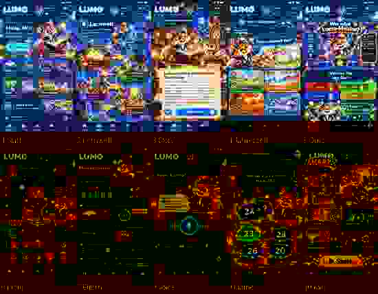
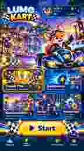

# LUMO NEXT GEN: Bildkatalog / verbindlicher Referenzstatus
Stand 20.10.2026. **Nur diese zwei kleinen JPG-Vorschaubilder wurden in diesem GitHub-Branch bereits als Git-Objekte nachweislich gespeichert:**

1.  – tatsächlicher Git-Pfad, 6.810 Bytes, 10 sehr kleine Vorschauen in einer Kontaktübersicht. **Nur Navigation/Zuordnung, keine ausreichend hochauflösende Produktionsvorlage.**
2.  – tatsächlicher Git-Pfad, 2.267 Bytes, kleiner Ausschnitt des Lumo-Kart-Menükonzepts. Nur Stilanker.

**Vollauflösende ChatGPT-Dateien (nicht auf GitHub eingecheckt):** Die Originalreferenzen befinden sich in einem separat im Chat bereitgestellten ZIP „LUMO_NEXTGEN_CODEX_REFERENZEN_2026-10-20.zip“. Sie sind hier absichtlich nicht als bereits vorhandene Repository-Dateien ausgegeben. Ein Codex-Lauf, dem diese ZIP nicht vorliegt, muss die vorhandenen echten Original-Lumo-Assets nutzen, die Vorschaubilder nur als Stil-/Farbkompass sehen und fehlende Vollbilder ehrlich in STATUS.md notieren.

## Vorgesehene Motive (Originaldateinamen im separat exportierten ZIP)
| Nr. | Screen | Original-PNG-Datei im ZIP | Wichtiger Umsetzungshinweis |
|---|---|---|---|
| 01 | Start-/Dashboard | lumo_lernabenteuer_im_sternenhimmel.png | UX aus aktueller Premium-Navigation darf nicht zurückgesetzt werden |
| 02 | Lernwelt/Fachnavigation | magische_lernwelt_mit_lumo_fox.png | Fach → Thema → reale Aufgabe, keine erzwungene zusätzliche Klickhürde |
| 03 | Deutsch/Story | lumo_und_die_geheimnisvolle_sternenuhr.png | Echte Texte und reale Vorlesefunktion |
| 04 | Sachunterricht/Jahreszeiten | lumo_jahreszeiten_quiz_mit_fuchs.png | Richtige Lösungen vom Datenmodell |
| 05 | Quizshow | lumo_meister_magisches_quiz_abenteuer.png | Joker nur wenn funktional vorhanden |
| 06 | Profil/Avatar | lumo_avatar_studio_im_zauberstadt_look.png | Mensch = Benutzeravatar, Lumo = Fuchs |
| 07 | Eltern/Statistik | leuchtendes_lumo_eltern_dashboard_im_sternenhimmel.png | Echte Werte, echte Elternfreigaben |
| 08 | KI/Sprachhelfer | magisches_lumo_lernabenteuer_bei_nacht.png | Sprachwellen nur bei realem Audio-/Zustandssignal |
| 09 | Mathe | magisches_mathe_abenteuer_mit_lumo.png | Echte korrekte Aufgabe, Versuch-2-Logik |
| 10 | **Lumo Kart Hauptmenü** | lumo_kart_neon_rennspass_am_sonnenhafen.png | Godot Controls + echter Kart/Originalfuchs, echte Navigation |

Zusätzliche Originalvarianten im ZIP:
- lumo_lernabenteuer_bei_nacht.png – alternative Startszene
- lumo_und_die_sternenkarte.png – zweite Storyillustration
- lumo_meister_quiznacht_im_sternenglanz.png – Quizshow-Alternative

## Verbindliche Abnahme
Die kleinen JPGs sind belegbar *im Repo*, die vollständigen PNGs nicht. **Weder die Vorschaubilder noch die PNG-Screens selbst als flache End-UI ausliefern!** Sie sind visuelle Entwürfe. Produktiv müssen echte responsive Elemente, eigenständige Assets und richtige Original-Lumo-Figur entstehen. Die vollständigen PNGs nur nutzen, wenn sie tatsächlich verfügbar gemacht wurden. Kein stiller Ersatz durch einen Jungen oder fremden Fuchs.

Siehe [vollständigen Produktionsauftrag](CODEX_GRAPHIC_3D_MASTER_BRIEF.md).