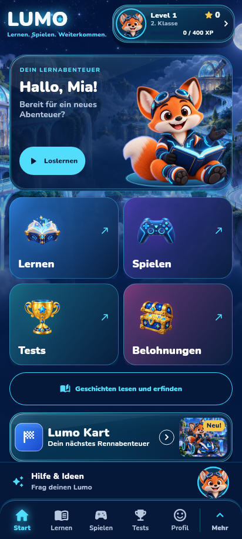
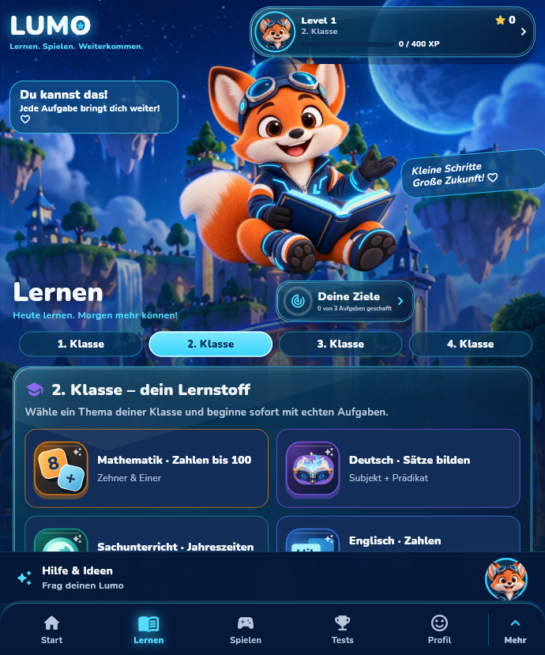
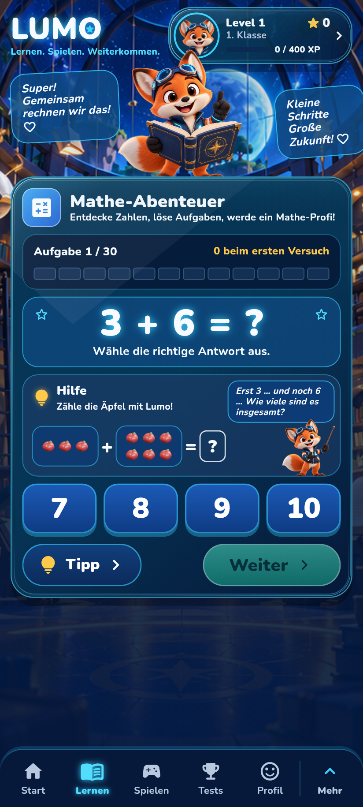
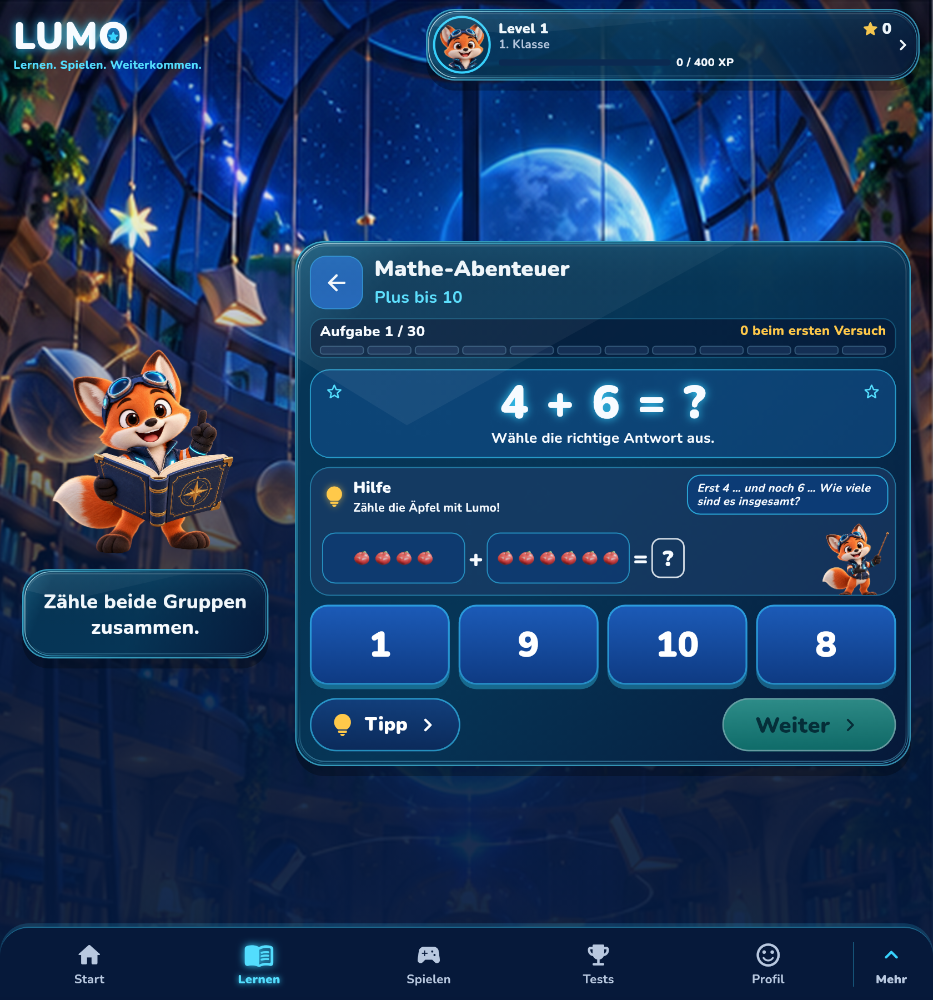
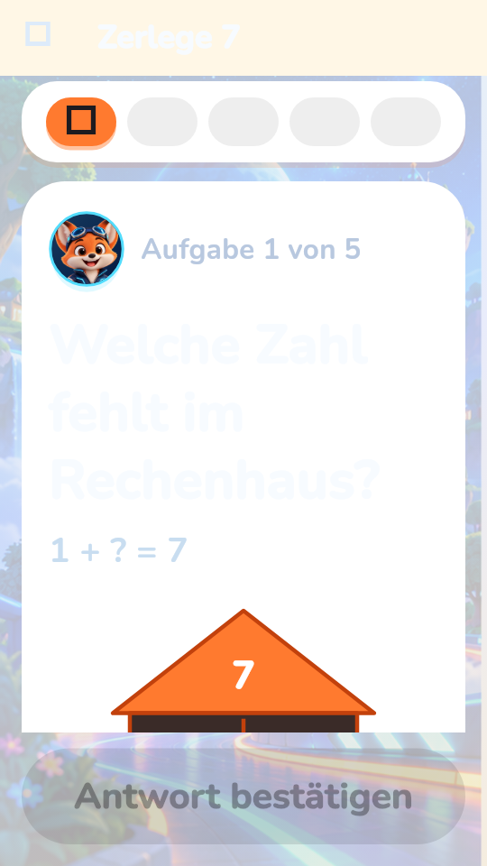
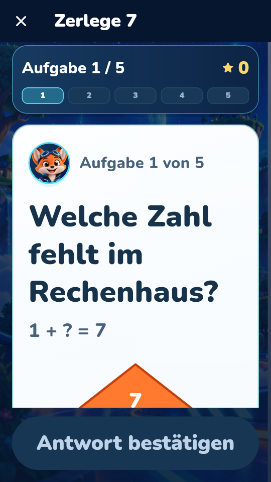
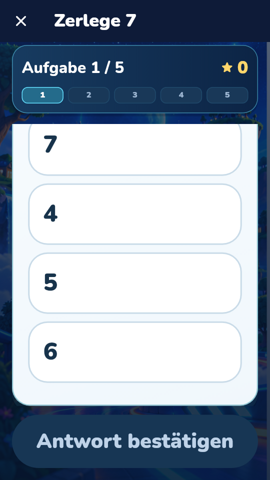
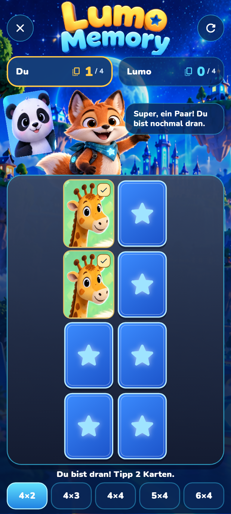
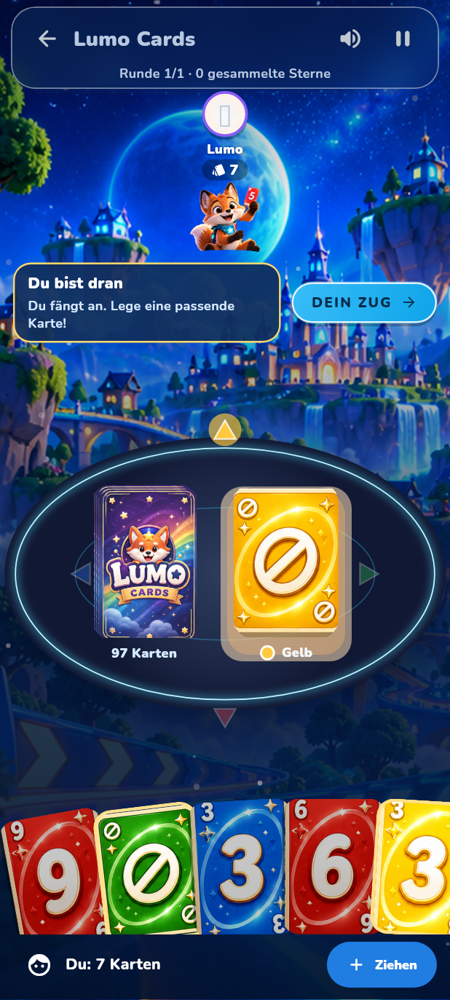

# Lumo 1977 premium learning and games

Safe fallback: APK **0.12.64+1976**, source PR #362 (`840708ac`), Godot
`6518a13f` / PR #100. Its code, artifact, package and saved-data formats are
preserved. This isolated candidate is **0.12.65+1977** and pins Godot
`efa1f69b4128a047e6196ee85762447e412db266` / PR #101.

## Implemented

- Shared glass bevel/reflected light, clearer original navigation artwork and
  large-text tabs that can scroll while the More menu remains reachable.
- Lesson progress animates real values, snaps immediately in reduced motion,
  mutes in hidden routes and leaves answer geometry intact on small displays.
  The shared frame serves 19 established modules. Plus's phone/Fold layouts
  retain their existing task, save and reward handling; large-text speech
  bubbles now flow without cutting the original fox or explanatory text.
- Rechenhaus, Sternenpfad, Farbenkisten and Buchstabenfüllen receive readable
  dark ink on light task panels, a navy/cyan stage and numbered round progress.
  Their existing rounds, answers, reward handling and pause clock remain intact.
- Dice shows actual player positions and readable status. Memory marks actual
  matched pairs and exposes the same state in semantics; score totals fit narrow
  displays. Cards improves the contrast of turn/deck counters and suppresses
  draw feedback in calm mode.
- Audio starts wait for native stop acknowledgements, preventing a delayed
  stop from interrupting the next greeting. F2/Sulafat voice identities and
  original audio files remain unchanged. No audible naturalness claim is made.
- The APK workflow archives both verified ARM64 and x86_64 packages plus source
  provenance, then installs the exact x86_64 package for an Android UI/race tour.

## Evidence

These PNGs are untouched frames from the actual Flutter widget trees with
original assets and Nunito/Material fonts. They are runtime UI renders on Linux,
not physical Fold7 screenshots. Rechenhaus's before/after contrast difference
comes from the same existing game, not a concept image.

The inventory JSON records the actual 402 app / 106 Godot branches and open PR
heads inspected before publishing this candidate. The candidate contains the
stacked Godot development through #100, rather than replacing it with an older
main branch. Historical evidence hashes are retained as historical evidence.

## Verification at source checkpoint

- 82 learning layout/safe-area/quantity/save checks passed.
- 43 focused game checks passed (including full Memory round, persistence,
  pause, Cards rounds, large text and final-source captures).
- 67 targeted voice tests passed; delayed native-stop regression observed RED
  before the production fix and GREEN afterward.
- 160 Python build/preservation tests: PASS, one Gradle-dependent local skip.
- 639 Android-QA Python tests: PASS on the starting suite; CI repeats them on
  this candidate.
- 15 native Godot probes and 56 Godot Python tooltests: PASS; independent
  Blender import verifies both new crystal GLBs. See Godot PR #101 for captures.
- Full final Flutter suite, unified APK and Android tour are separate gates;
  use the current linked Actions results, not these targeted counts, to assess
  their completion.

Physical Fold7 frame times/60 FPS, a new voice recording quality review, complete
premium art passes for every remaining game/world and console-quality equivalence
remain open. Existing premium Connect Four and creative Godot games are preserved
and included in regression coverage; they are not claimed as new art in this pass.
