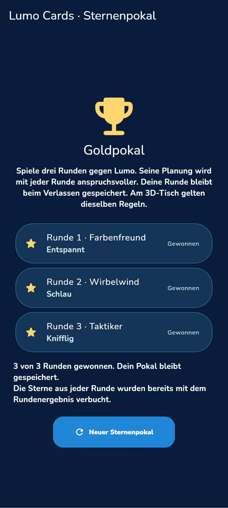

# LUMO Cards: nativer 3D-Tisch und Sternenpokal

Stand der lokalen Prüfung: 2026-11-13. Dies ist ein Entwicklungsnachweis, keine Freigabe und kein 60-FPS-Nachweis.

## Tatsächlicher Ausgangszustand

Die Flutter-App enthielt ein vollständiges Kartenspiel mit 112 Karten, fünf Regelphasen, fairer regelbasierter KI in drei Schwierigkeitsstufen und drei Stilen, klassenabhängigen Lernfragen, lokalen Zwei-Personen-Runden sowie dauerhaftem Rundenstand. Siegesserie, Lernfragenbonus und LUMO!-Ruf waren bereits mit idempotenten Ergebniskennungen an das vorhandene Wallet angebunden. Die Spieloberfläche bestand aus Flutter-Widgets und perspektivisch angeordneten Bildern; ein produktiver Godot-Kartentisch und ein über mehrere Runden gespeicherter Pokal fehlten.

## Neue, angeschlossene Implementierung

- `LumoCardsScreen` öffnet auf Android über die sichtbare 3D-Schaltfläche den registrierten Godot-Spielpfad `cards`. Die klassische Solo- und Zwei-Personen-Oberfläche bleibt direkt nutzbar.
- `scenes/games/cards_table.tscn` im Godot-Repository rendert einen echten Tisch mit Holz, Filz, Messingrand, abgerundetem Walnussrand, Tischbeinen, gepolstertem Stuhl, getäfelten Wänden, Regalen, tiefen Fenstern, warmen Leselampen und räumlichen Kartengeometrien. Karten besitzen Dicke, PBR-Oberflächen, Schatten und die unveränderten Original-Kartentexturen. Der Original-Lumo mit seinem bestehenden Rig sitzt gegenüber und reagiert auf Spielzüge. `cards_table_actor.gd` sampelt den originalen Sitzclip ohne Stand-Übergangsblend, hält die zehn vorhandenen Beinrotationen während oberkörperbetonter Reaktionen und richtet das Becken am tatsächlichen Stuhlsitz aus. In kurzem Querformat werden die Aktionszeilen zusammengeführt; der Ablagestapel bleibt vor den Handkarten vollständig sichtbar.
- Die Handkarten sind echte Meshes. Antippen hebt eine erlaubte Karte an; ein zweites Antippen oder „Karte legen“ sendet den genauen Kartenbezug. Neue Karten bewegen sich vom Nachziehstapel in die Hand, gelegte Karten zum Ablagestapel. Große Hände sind blätterbar. Ruhiger Modus lässt diese Bewegungen aus.
- Farbwahl, Lernfrage, Geräteübergabe, Pause und Rundenergebnis sind an dieselben bestehenden Regelphasen angeschlossen. Der LUMO!-Ruf benutzt denselben bisherigen Bonuspfad. Der Gegner sieht weiterhin nur seine eigene Hand sowie öffentliche Informationen.
- Der neue Sternenpokal ist über die bestehende Cards-Auswahl erreichbar: drei Runden gegen Farbenfreund/Entspannt, Wirbelwind/Schlau und Taktiker/Knifflig. Während eines Pokals sind die Gegnerstufen fest. Alle Runden können auch am 3D-Tisch gespielt werden. Gewonnene Runden bestimmen Gold-, Silber-, Bronze- oder Entdeckerpokal; es gibt keine zweite Auszahlung der bereits vergüteten Rundensiege.

## Eine einzige Regelautorität über zwei Android-Prozesse

Godot läuft in der vorhandenen privaten Activity im Prozess `:lumo_game`. Flutter bleibt Besitzer von Regeln, verdeckten Karten, Profil, Spielstand und Belohnungen. Es gibt keine zweite Regelkopie in GDScript.

`CardsTableBridge.kt` überträgt ausschließlich einen begrenzten öffentlichen Zustand und einzelne Eingabewünsche über `files/lumo_cards_table_v1/<zufällige 32-Hex-Kennung>/`. Die festen Dateien heißen `state.json`, `request.json` und `lifecycle.json`. Zustand und Eingaben werden atomar geschrieben; eine Dateisperre synchronisiert auch die getrennten Prozesse. Der Zustand ist auf 256 KiB begrenzt, eine Eingabe auf 4 KiB. Es gibt keine frei wählbaren Dateipfade und keinen Netzverkehr.

Eine Eingabe muss Sitzung, veröffentlichte Revision und steigende Sequenz treffen. Es ist höchstens eine unbestätigte Eingabe zugelassen. Flutter prüft zusätzlich, ob sich der tatsächliche Regelzustand seit Veröffentlichung verändert hat. Eine Bestätigung folgt erst nach erfolgreicher Speicherung. Wiederholung, veraltete Revision, fremde Kartenkennung und Schreibfehler dürfen keinen zweiten Spielzug auslösen. Der öffentliche Zustand enthält weder gegnerische Kartenkennungen noch Nachziehreihenfolge oder die richtige Lernantwort.

Android muss auch erkennen, dass der Hauptprozess weiterhin für das sichtbare Spiel benötigt wird. Deshalb bindet `LumoGameActivity` ausschließlich während sichtbarer Cards-Sitzungen (`onStart` bis `onStop`) den privaten `CardsAuthorityService` im Hauptprozess mit `BIND_AUTO_CREATE`. Der Service ist nicht exportiert, hat kein eigenes Prozessattribut und wird nie als dauerhafter oder Foreground-Service gestartet. Sein Binder prüft das Flutter-Engine-Attachment und die genaue aktuell im Arbeitsspeicher registrierte Sitzung; er enthält keine Spielregeln. `CardsAuthorityRegistry.java` widerruft alle Sitzungen bei Engine-Wechsel oder Detach und den einzelnen Token vor Dateibereinigung. Ein neuer Prozess kann aus einer liegengebliebenen `state.json` keine Autorität zurückgewinnen. Auch Flutter-Publish und Poll verlangen die noch aktive Registrierung. Das vermeidet die ungesicherte Annahme, ein vollständig verdeckter Flutter-Prozess werde immer weiter eingeplant. Android dokumentiert die eingeschränkte Ausführung gecachter Prozesse seit Android 13 sowie die Prozesspriorität gebundener Dienste: [Prozesslebenszyklus](https://developer.android.com/guide/components/activities/process-lifecycle), [gebundene Dienste](https://developer.android.com/develop/background-work/services/bound-services).

Während des nativen Tisches wird der normale Flutter-Pausenbeobachter durch den nativen Activity-Heartbeat ersetzt. Hintergrundwechsel und ein länger als 2,5 Sekunden fehlender Heartbeat pausieren dieselbe Spieluhr. Eine monotone `pauseEpoch` bewahrt den Hintergrundwechsel auch dann, wenn Dart zwischen nativem Pausieren und Fortsetzen keine Rechenzeit erhielt; Fortsetzen erfolgt ausdrücklich über „Weiterspielen“. Rückkehr zeigt die ursprüngliche Runde pausiert. Die vorhandene Tagesmissions-/Elternfreigabe wird vor Öffnen geladen und während der nativen Bedienung weiterhin mit `canPlayToday` geprüft; ein Entzug beendet die Sitzung ohne weiteren Spielzug. Eine aktuelle Profil-Lease wird vor Öffnen, während der Bedienung und beim Speichern geprüft: `isCurrentLearningLease` dient der aktuellen Interaktion; `canUseLearningLease` bleibt für zulässige Schreibaufträge an den bereits erfassten ursprünglichen Besitzer. Bei Profilwechsel verschwinden die bisherige Hand, die offene Lernfrage, Zähler, Bonusknopf und der Pokal. Das temporäre Sitzungsverzeichnis wird geschlossen; Rundenstände bleiben erhalten. Die globale leere `bridge.lock`-Datei enthält keine Spieldaten.

## Bestandsschutz

Der bestehende Rundenschlüssel `lumo.cards.round.v1.<Besitzerhash>.<Klasse>.solo|local` und sein Datenformat bleiben unverändert. Pokalrunden verwenden ausschließlich zusätzliche, validierte Slots `cup-cards-<32hex>-0|1|2`. Der Pokal liegt unter `lumo.cards.cup.v1.<Besitzerhash>.<Klasse>` und enthält maximal drei abgeschlossene Rundenergebnisse. Ergebnisse sind nach Rundennummer und Rundenkennung dedupliziert; widersprüchliche, vorgezogene oder fremde Ergebnisse werden abgewiesen. Ein Speicherfehler lässt sich mit derselben Ergebniskennung erneut versuchen. Ein neuer Pokal ersetzt erst nach drei gespielten Runden den abgeschlossenen Pokal. Keine Migration bestehender Kinder- oder Schreibdaten.

## Tatsächlich ausgeführte lokale Prüfungen

| Prüfung | Neues Ergebnis |
|---|---|
| Acht Flutter-Testdateien für Tischautorität, Pokal, Wiederaufnahme, Persistenz, Auszahlung und Layout | 39 Tests bestanden |
| Pokal-UI nach abschließender Kontrastkorrektur | 6 Tests bestanden |
| Godot `scripts/tests/cards_table_regression.gd` | `CARDS_TABLE_RUNTIME_PASS checks=140 failures=0` |
| JVM-Regression `scripts.tests.test_cards_authority_registry`, tatsächlich kompilierte Produktionsklasse | 5 Tests bestanden: echte liegengebliebene Datei, neue Prozessinstanz, Detach/Attach, Close vor Cleanup, fremde/ungültige Kennungen |
| Android-Host-Installationsfixture `scripts.tests.test_embedded_android` | 1 Test bestanden, einschließlich privatem Mainprozess-Service und wiederholbarer Manifestgenerierung |
| Echter Android-Kotlin/Java-Hostcompile, gemeinsamer Stand `c9e05e24` | [CI 43353261145](https://github.com/Ullmann27/lumo-lernen/actions/runs/43353261145), Job 131649128007 bestanden, einschließlich AuthorityService und Pause-Epoche |
| Flutter-Analyzer für Cards und die neuen Tests | Keine Befunde |
| 59 kopierte Original-Karten-PNGs gegen Flutter-Quellen | Alle SHA-256 byteidentisch |

Die Tischautoritätsprüfung spielt zwölf vollständige Runden durch den Nachrichtenadapter, prüft alle fünf Phasen und liest nach den Spielzügen den gespeicherten 112-Karten-Bestand erneut. Weitere Fälle prüfen Schreibfehler ohne doppelte Aktion, falsche Kennung/Revision/Karte, Hintergrundwechsel und Profilinvalidierung. Der native Test trifft die projizierte echte Kartengeometrie mit Touch-Ereignissen, prüft Befehlsdaten und Bestätigungssperre sowie Bedienelemente mit mindestens 48 dp in vier Formaten einschließlich Dichte 2,625.

Die Pokal-UI-Prüfung verwendet ausdrücklich legale, gespeicherte Letzte-Karte-Testpositionen mit jeweils allen 112 Karten. Sie führt die drei Gewinnzüge über die tatsächlichen Spielknöpfe/Karten aus, startet nach jeder Runde einen neuen AppState, prüft den unveränderten klassischen Spielstand und erhält genau 12 Sterne und 75 XP aus der vorhandenen Siegesserie. Das ist ein Test des neuen Pokalabschlusses und der Wiederaufnahme, kein behaupteter vollständiger manueller Drei-Runden-Android-Durchlauf. Die zwölf vollständigen Adapterrunden sind ein separater Test.

Die Abbildung stammt aus `test/lumo_cards_cup_widget_test.dart` über einen echten Flutter-RepaintBoundary-Capture bei 412 × 915 logischen Pixeln. Sie ist keine Godot-Abbildung und kein Android-Gerätenachweis. Reproduktion: Umgebungsvariable `LUMO_CARDS_CUP_CAPTURE` auf den PNG-Ausgabepfad setzen und diesen Test ausführen.

## Noch getrennt nachzuweisen

- Der Android-Kotlin/Java-Host hat im genannten CI-Lauf kompiliert. Die spätere sitzungsgenaue Registry samt Kotlin-Anbindung benötigt einen neuen gemeinsamen Hostcompile. Der lokal ausgeführte JVM-Test prüft die tatsächliche Registry-Produktionsklasse, keine Android-Prozesse. Auch ein erfolgreicher Hostcompile ist noch kein Lauf der App oder der IPC auf Android.
- Vier tatsächliche X11-Rendererbilder des ersten nativen Tischstands (`d66aae`) wurden gesichtet. Sie zeigten zu helle Materialien, einen zu kleinen Lumo und im dichten Querformat teilweise verdeckte Tischkarten. Vier neue Bilder des Stands `096c9d20` wurden ebenfalls einzeln geöffnet: Sitzpose, Karten und Ablagestapel sind in allen Formaten sichtbar; der Holzkontrast ist noch zu dominant. Die tatsächlichen Desktop-Drawcalls betragen je nach Format 460 bis 869 bei rund 129.000 bis 178.000 Primitiven. Eine gezielte Materialkorrektur und statisches Batching werden deshalb vor der nächsten Bildabnahme vorgenommen; spätere Messwerte dürfen diesem früheren Stand nicht zugeschrieben werden. Reproduktion mit `scripts/tests/cards_table_capture.gd` erzeugt. Der Test verweigert ausdrücklich Headless-Capture. Erwartet werden vier Bilder und `CARDS_TABLE_RENDER_PASS`; `LUMO_CAPTURE_DIR` bzw. `--output` bestimmt den Ablageort. `cards-render.json` ergänzt tatsächliche Drawcalls und sichtbare Primitive je Bild; diese Desktopwerte sind ausdrücklich keine Geräte-FPS. Die öffentliche Kartenlage ist ein klar gekennzeichnetes Renderfixture der produktiven Szene.
- Der Android-Test muss von der echten Flutter-Navigation aus den nativen Tisch öffnen, „Ziehen“ auslösen, Bestätigung/Revision und denselben gespeicherten Rundenbezug lesen, Hintergrund/Pause/Zurück prüfen und dieselbe Runde wieder öffnen. Zusätzlich sollen eine tatsächliche OS-Servicebindung und ein weiterer realer Zug nach 35 Sekunden sichtbarer Wartezeit nachgewiesen werden. Er darf keine Nachrichten oder Spielstände einspeisen.
- Es liegt lokal kein Messnachweis für 60 FPS, Touch-Latenz oder thermisches Dauerverhalten auf einem Galaxy Z Fold7 vor. Headless-Prüfungen belegen diese Eigenschaften nicht.
- Screenshots eines Renderfixtures allein belegen ebenfalls noch keine funktionierende Android-Prozessverbindung. GitHub-Commit, CI-Läufe, endgültiger PCK-Pin und APK müssen am tatsächlich geprüften gemeinsamen Stand ergänzt werden.
